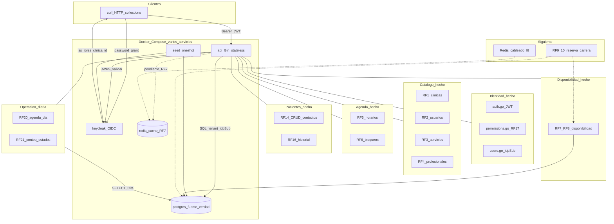

# Arquitectura Etapa 1 — MediCitas

Mapa vivo del sistema **real** (Compose multi-servicio). No es el diagrama V2 de microservicios por entidad: aquí la prioridad es **consistencia** (Postgres fuente de verdad), luego **stateless** (JWT) y **tiempo de respuesta** (Redis solo para RF7).

## Vista general

## Tubo de una petición autenticada

1. Cliente obtiene JWT en Keycloak (`client_id=api`).
2. `api` valida firma (JWKS), `iss`, `exp`.
3. `requirePerm` / matriz RF17.
4. `loadDomainUser`: `"Usuario"."idpSub" = JWT.sub` → clínica de dominio.
5. Handler filtra por esa clínica (I5); nunca confía un `clinicaId` del query/body.

## Tabla de progreso (rellenable)

| Bloque | RF / pieza | Estado |
|--------|------------|--------|
| Compose | api, db, keycloak, redis, seed | Hecho |
| Identidad | JWT, matriz, idpSub, `/me` | Hecho |
| RF1–RF4 | Clínicas, usuarios, servicios, profesionales | Hecho |
| RF5–RF6 | Horarios, bloqueos | Hecho |
| RF14, RF16 | Pacientes/contactos, historial | Hecho |
| RF7–RF8 | Disponibilidad (API) | Hecho |
| **RF20** | Agenda del día | **Hecho** |
| **RF21** | Conteo por estado | **Hecho** |
| Redis I8 | Cableado caché en RF7 | Pendiente |
| RF9–RF13 | Ciclo de cita + carrera | Pendiente |
| RF15, RF18–RF19 | Notas, bitácora | Pendiente |
| Módulo extra | p. ej. RLS | Pendiente |

## Defensa en una frase

Varios servicios Compose; una fuente de verdad relacional; identidad delegada; caché solo donde el enunciado lo pide (RF7), sin contradecir Postgres (I8).
