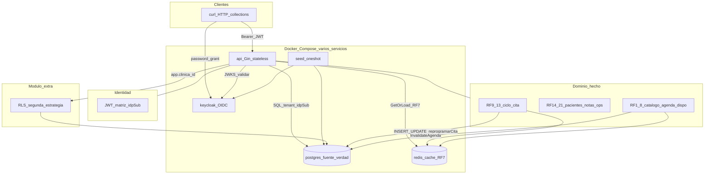
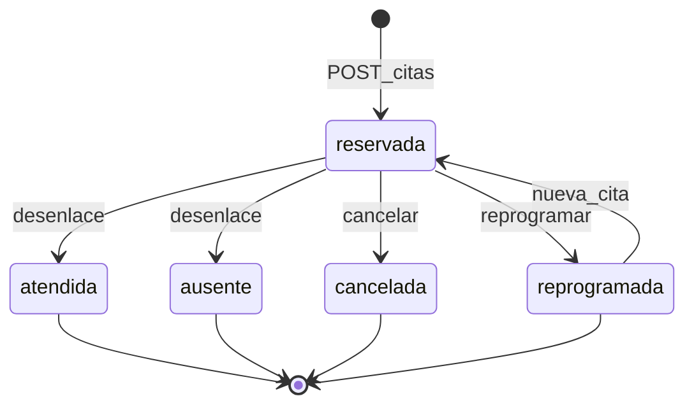

# Arquitectura Etapa 1 — MediCitas

Mapa vivo del sistema **real** (Compose multi-servicio). Prioridad: **consistencia** (Postgres), **stateless** (JWT), **latencia** (Redis RF7 sin contradecir PG: I8).

## Vista general

## Ciclo de la cita

Concurrencia RF9: **READ COMMITTED** + `EXCLUDE` GiST. RF10: `app.reprogramarCita` atómica. RF13: `validarTransicionCita` + filtros `estado = reservada` en API.

## Tabla de progreso

| Bloque | Estado |
|--------|--------|
| Compose + identidad | Hecho |
| RF1–RF8 | Hecho |
| RF14–RF16, RF15, RF18–RF21 | Hecho |
| Redis / I8 en RF7 | Hecho |
| **RF9–RF13 ciclo + carrera** | **Hecho** |
| Módulo extra: RLS | Hecho |

## Defensa en una frase

Compose multi-servicio; Postgres como verdad; JWT multi-tenant con RLS encima de `clinicaId`; reserva concurrente con una ganadora; caché de disponibilidad invalidada al mutar la agenda.
