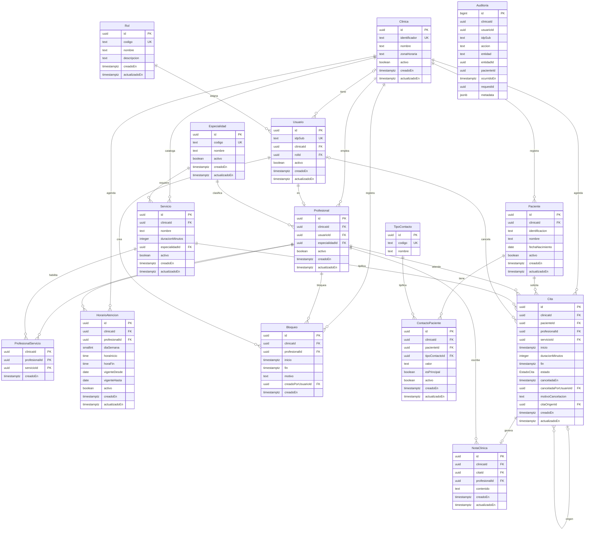
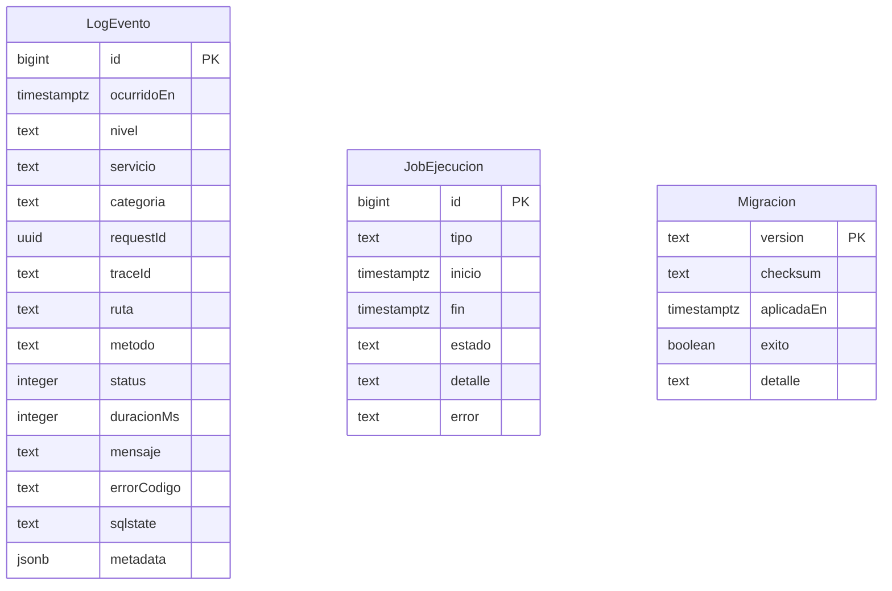

# Esquema entidad-relación - MediCitas

Diagrama del esquema creado en [`db/migrations/01_schema.sql`](../db/migrations/01_schema.sql).

- **PK**: clave primaria.
- **FK**: clave foránea.
- **UK**: restricción de unicidad.
- Todas las tablas de negocio llevan `clinicaId` y usan FKs compuestas por clínica para impedir referencias entre tenants.
- `Auditoria` no tiene FKs a propósito: debe conservar el rastro aunque se desactiven usuarios o pacientes.
- El esquema `ops` es técnico y no contiene datos clínicos ni datos de contacto.

## Esquema `public`

## Esquema `ops`

## Notas del modelo

- **Estados de la cita:** `reservada`, `atendida`, `ausente`, `cancelada` y `reprogramada`. Los cuatro últimos son finales.
- **Cancelación:** vive en `Cita` mediante `canceladaEn`, `canceladaPorUsuarioId` y `motivoCancelacion`.
- **Reprogramación:** la cita original pasa a `reprogramada` y se crea otra cita con `citaOrigenId` apuntando a la anterior.
- **Duración:** `Cita.duracionMinutos` es una instantánea de `Servicio.duracionMinutos`; `fin` se calcula al insertar.
- **Solapamientos:** `Cita` tiene restricciones de exclusión por profesional y por paciente para citas `reservada`.
- **Horario y bloqueos:** se validan al insertar una cita, usando la zona horaria de `Clinica`.
- **Nota clínica:** solo se permite en citas `atendida` y la FK compuesta obliga a que la escriba el profesional de la cita.
- **Auditoría:** `Auditoria` es append-only; los triggers bloquean `UPDATE`, `DELETE` y `TRUNCATE`.
- **RLS:** pendiente en una migración posterior. Las columnas `clinicaId` y las FKs compuestas ya están preparadas.

## Cómo visualizarlo

- En GitHub, este archivo se renderiza automáticamente.
- En VS Code, con la extensión **Markdown Preview Mermaid Support**.
- En el [Mermaid Live Editor](https://mermaid.live/), pegando el contenido de los bloques `mermaid`.
- Contra la base real, con DBeaver: seleccionar las tablas de `public` o `ops` y abrir **ER Diagram**.
