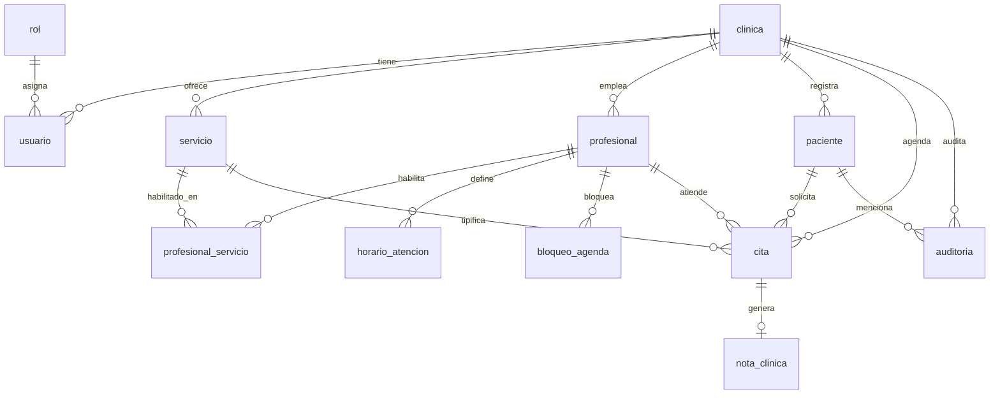

# Modelo de datos — MediCitas (borrador Fundación)

Documento vivo para el avance obligatorio. Atributos y tipos se ajustan en el diccionario definitivo; aquí se fija el esqueleto en **3FN** orientado a multi-tenancy por columna `clinica_id`.

## Entidades (mínimo del enunciado)

| Entidad | Responsabilidad | Notas |
|---------|-----------------|-------|
| **clinica** | Tenant | `clinica_id`, nombre, zona horaria |
| **rol** | Catálogo de roles de dominio | Códigos alineados con Keycloak: `adm-plataforma`, `adm-clinica`, `recepcion`, `profesional` |
| **usuario** | Persona del sistema | Solo `idp_sub` (Keycloak), `clinica_id` (NULL si adm. plataforma), `rol_id`, baja lógica |
| **servicio** | Tipo de consulta | Nombre, duración en minutos, especialidad; pertenece a una clínica |
| **profesional** | Quién atiende | Especialidad; opcional enlace a `usuario` |
| **profesional_servicio** | N:M | Qué servicios puede atender un profesional |
| **horario_atencion** | Bloques semanales | Varios por día (jornada partida) |
| **bloqueo_agenda** | Vacaciones / permisos | Rango `inicio`–`fin`; no cancela citas previas (lista conflictos) |
| **paciente** | Atendido por recepción | Identificación única **por clínica**, contacto |
| **cita** | Espacio reservado | Paciente + profesional + servicio + intervalo; máquina de estados |
| **nota_clinica** | Dato sensible | 1:1 con cita atendida; solo el profesional que atendió |
| **auditoria** | Bitácora append-only | Quién, qué, paciente, cuándo; sin UPDATE/DELETE de app |

## Estados de la cita (RF13)

```
reservada → atendida | ausente | cancelada | reprogramada
```

Los cuatro estados finales no admiten salida. La duración la fija el **servicio** (I4), no un campo editable suelto en la cita.

## Diagrama entidad-relación (borrador)



## Normalización (esbozo 3FN)

1. **1FN:** atributos atómicos; horarios como filas (no CSV de franjas); contactos de paciente como columnas simples.
2. **2FN:** N:M `profesional_servicio` separada; duración vive en `servicio`, no repetida por cita vigente.
3. **3FN:** especialidad del profesional no determina el tenant; `clinica_id` se propaga a hechos (cita, nota, auditoría) para aislar sin depender solo de joins largos.

Desnormalización deliberada (si aparece): materializar `fin` en `cita` para solapes — documentar motivo (I1/I7) cuando se implemente.

## Semilla mínima (requisito)

Al menos **tres clínicas**, varios profesionales por clínica y citas repartidas en el tiempo. Identificadores provisionales:

- `clinica-norte`
- `clinica-centro`
- `clinica-sur`

## Diccionario (pendiente de completar)

Tabla a completar en la entrega: nombre de columna, tipo SQL, nulo, FK, descripción, invariante relacionado (I1–I8).
