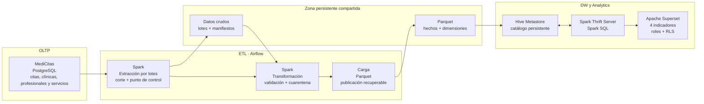

# Plataforma analítica OLAP de MediCitas

**Unidad de Ingeniería en Computación · Sede Central Cartago**
**Arquitectura e Ingeniería de Datos**
*Profesor: Kenneth Obando*

**Proyecto Semestral · Etapa 2 (15%)** — Fecha de entrega: _(se publica en Discord)_

---

> **Instrucciones**
> Esta etapa se desarrolla en tres semanas, sobre el mismo sistema y repositorio de la Etapa 1. Se trabaja en grupos de dos o tres personas; los grupos de tres incluyen el módulo SCD tipo 2, que no otorga puntos extra. Las fechas oficiales de entrega y defensa se publican en Discord. Lea todos los requisitos y criterios de aceptación antes de repartir el trabajo.

## 1 Descripción y propósito

Con el núcleo transaccional de MediCitas en funcionamiento, los administradores de las clínicas pueden operar sus agendas, aunque todavía les cuesta responder preguntas sobre lo que ocurre a lo largo del tiempo. Necesitan conocer la demanda, las ausencias y las cancelaciones. Consultar directamente las tablas operativas permite obtener algunas respuestas, pero comparte recursos con las reservas y obliga a interpretar datos que siguen cambiando mientras se prepara el reporte.

En esta etapa el grupo construye una capa analítica a partir de extracciones por lotes del OLTP. Airflow coordina el proceso ETL, Spark transforma los datos y un almacén dimensional permite consultarlos con criterios de negocio explícitos. El trabajo se concentra en la carga incremental, la calidad y la recuperación: tener contenedores activos no demuestra que los indicadores sean correctos.

La defensa retomará la siguiente pregunta:

> *Si un registro se procesa dos veces o una ejecución falla y se repite, ¿los indicadores siguen siendo correctos? ¿Cómo lo demuestra el grupo?*

El trabajo parte del producto entregado en la Etapa 1. Para distinguir el incremento que se evalúa, el grupo identifica aquella versión con un tag o commit y documenta los cambios realizados. Las reservas, sus transacciones, la identidad en Keycloak, el aislamiento entre clínicas y la caché Redis deben seguir operando. Si una modificación de esta etapa rompe alguna de esas funciones, la regresión forma parte de la evaluación.

## 2 Arquitectura y límites

El recorrido mínimo de los datos es el siguiente:

*Todo corre localmente con Docker Compose. Kafka, Neo4j y outbox no forman parte del alcance de esta etapa.*

La extracción lee los datos operativos con una cuenta de permisos mínimos. Spark ejecuta las transformaciones y el warehouse responde las consultas dimensionales. No se requiere un intermediario de mensajería ni una base de grafos. El diagrama editable de referencia se entrega como `diagramas/etapa2-arquitectura.excalidraw`; representa el alcance mínimo, no una topología adicional que deba implementarse.

Todo corre localmente con Docker Compose, Spark en modo local y archivos en un volumen persistente como zona de datos crudos. El warehouse se implementa con tablas Parquet catalogadas en un Hive Metastore persistente y consultadas mediante Spark SQL. Los hechos y las dimensiones viven en archivos separados del OLTP; el metastore guarda sus esquemas, ubicaciones y particiones, no los registros de negocio. PostgreSQL puede respaldar los metadatos, pero no sustituye los archivos del warehouse. El lenguaje de la aplicación existente se mantiene libre y las transformaciones de esta etapa se implementan con PySpark.

Se utilizará un entorno base de Docker Compose proporcionado por el docente, con versiones compatibles de Spark, Hive Metastore y Apache Superset, incluido Spark Thrift Server y el driver de conexión. Superset se conecta a Spark SQL mediante ese servidor; no consulta el OLTP ni los metadatos PostgreSQL como si fueran el warehouse. Spark Thrift Server comparte catálogo y volumen con los jobs. Este endpoint usa el protocolo HiveServer2, pero el motor de consulta sigue siendo Spark; no se incorpora un motor Hive independiente. El grupo conserva esa configuración y la integra a MediCitas. Los procesos que leen o escriben el warehouse deben acceder al mismo volumen persistente y a las mismas rutas; una ruta local distinta en cada contenedor no constituye almacenamiento compartido. No se exige un clúster distribuido ni una cuenta de nube.

Quedan fuera del alcance obligatorio Kafka, Neo4j, outbox transaccional, MongoDB y la migración de fichas clínicas, Kubernetes, Terraform, LocalStack, MinIO, sharding, réplicas y failover, sagas, un servidor Hive independiente, HDFS, YARN, tablas Hive ACID, Structured Streaming, un stack completo de observabilidad y un plan integral de recuperación ante desastres. Tampoco se exige frontend nuevo, aprendizaje automático ni recomendaciones clínicas. Estas exclusiones sustituyen para esta etapa los requisitos más amplios del enunciado antiguo de P2. Las ampliaciones voluntarias no sustituyen el núcleo ni otorgan puntos extra.

## 3 Requisitos funcionales y técnicos

Los códigos E2 permiten vincular implementación, pruebas y evidencia. Todos los requisitos de esta sección aplican a grupos de dos y de tres.

### Origen e ingesta confiable

**E2-1. Datos de origen.** Documentar el esquema de extracción de citas y dimensiones, con identificadores de clínica y cita, atributos analíticos, fechas, estado y una versión monotónica por cita. Las operaciones de creación, cancelación, reprogramación y desenlace deben reflejarse en el siguiente lote. Se permite agregar al OLTP una versión y una marca de actualización mantenidas en la misma transacción de negocio. No se exige conservar cada estado intermedio: se analiza el último estado confirmado de cada cita. No usar borrado físico de citas; representar cancelaciones y reprogramaciones mediante sus estados.

**E2-2. Selección incremental y punto de control.** Definir cómo se detectan las citas nuevas o modificadas desde la última extracción correcta. Documentar límites de la ventana, desempates y tratamiento de transacciones concurrentes. Se permite pausar brevemente las escrituras durante la extracción y registrar un corte consistente; no se exige captura en caliente ni infraestructura CDC. No basta avanzar al máximo identificador de cita, pues se perderían cambios en citas existentes. Si se usan marcas temporales, justificar cómo se evitan huecos por empates o confirmaciones tardías. Solo avanzar el punto de control de extracción después de persistir y validar el lote; la aplicación al warehouse tiene su propio estado para reintentar lotes pendientes.

**E2-3. Lotes recuperables.** Conservar cada extracción en archivos crudos, con identificador de lote, ventana o corte, esquema, cantidad de registros y estado de finalización. Una escritura incompleta no se considera un lote listo. Los archivos completos se conservan para auditoría y reprocesamiento. Tras una falla se retoma desde el último punto de control seguro; se admiten relecturas, pero no pérdidas silenciosas. No es necesario un proceso de extracción continuo.

### Carga histórica, Spark y Airflow

**E2-4. Carga inicial e incremental.** El warehouse se puebla con una carga histórica del OLTP y luego recibe las citas nuevas o modificadas. El grupo debe documentar el punto de corte entre ambas cargas, explicar cómo evita huecos y resolver los registros que puedan aparecer en las dos. Para la carga inicial se permite detener temporalmente las escrituras, registrar el corte y reanudarlas al terminar. No se exige captura en caliente. El procesamiento incremental no puede consistir en borrar y recargar toda la base analítica en cada ejecución.

**E2-5. Transformaciones con PySpark.** Los jobs deben trabajar con un esquema explícito, validar campos, normalizar fechas y zonas horarias, eliminar duplicados e integrar los datos con las dimensiones para preparar los hechos. Los registros atrasados se resuelven mediante la versión de la cita, de modo que una versión antigua no revierta un estado más reciente. La deduplicación debe funcionar entre ejecuciones, no solo dentro de un DataFrame. Los registros rechazados se conservan por separado con su motivo; descartarlos sin dejar rastro impide explicar las diferencias entre el origen y el destino. El trabajo principal no puede delegarse a pandas ni a un bucle Python que sustituya las transformaciones de Spark.

**E2-6. DAG de Airflow.** Se entrega al menos un DAG con tareas distinguibles para extracción, transformación Spark, validación y carga, con dependencias, reintentos y parámetros para seleccionar lotes o periodos. Debe admitir ejecución programada y manual, así como reprocesar un periodo sin editar el código. Una tarea que falla debe quedar marcada como tal y no permitir que los pasos dependientes aparenten éxito. Evitar ejecuciones solapadas que corrompan la carga; se permite limitar el DAG a una ejecución activa. Registrar cantidades leídas, válidas, rechazadas y aplicadas, tiempos y estado por ejecución.

### Modelo dimensional y resultados

**E2-7. Warehouse.** El modelo será una estrella cuyo hecho principal represente una cita identificada dentro de una clínica, mediante un snapshot acumulativo de su ciclo de vida. Esta granularidad distingue la cita de las versiones que la modifican. El modelo debe incluir dimensiones de fecha, clínica, profesional y servicio, claves sustitutas y correspondencia con las claves de origen. Las tablas Parquet deben registrarse en Hive Metastore y ser consultables por nombre desde Spark SQL en una sesión nueva, sin depender de vistas temporales del notebook. El grupo valida en el ETL la unicidad, los campos obligatorios y las referencias entre hechos y dimensiones; no se presume que el catálogo imponga esas restricciones. La tabla de hechos se particiona por un criterio justificado, por ejemplo el mes de atención programada, evitando particiones excesivamente pequeñas. La dimensión fecha puede usarse con distintos roles (creación y atención programada). Documentar medidas, atributos, relaciones y la política para dimensiones aún no disponibles.

**E2-8. Actualizaciones idempotentes.** Una cancelación o desenlace actualiza el hecho existente; repetir un registro o lote no agrega otra cita. La reprogramación conserva el estado de la cita original y, cuando el OLTP crea otra cita, su identidad y su vínculo con la anterior. Nunca se registra el mismo identificador como dos hechos por haber recibido dos versiones. Conservar la versión aplicada o un mecanismo equivalente que impida retrocesos.

Para actualizar los hechos, Spark reconstruye únicamente las particiones afectadas, combinando el contenido previo con los cambios del lote y conservando las citas que no cambiaron. Si un registro cambia de partición, se consideran tanto su ubicación anterior como la nueva. No se presupone soporte de UPDATE o MERGE transaccional sobre archivos Parquet. Las dimensiones pequeñas pueden reconstruirse por completo, siempre que se mantengan estables las claves sustitutas y, cuando aplique, su historia SCD.

La publicación debe usar una zona de preparación separada, validación antes de sustituir los datos visibles y un registro de las particiones pendientes y completadas. Se permite bloquear las consultas analíticas durante la publicación y la recuperación, manteniendo el OLTP operativo. Ante una falla, las consultas no se habilitan hasta completar o revertir el cambio. Documentar y probar este procedimiento; sobrescribir archivos no garantiza por sí solo atomicidad entre varias particiones.

**E2-9. Indicadores.** Entregar las cuatro consultas siguientes sobre el warehouse mediante Spark SQL y un dashboard obligatorio en Apache Superset. Un notebook puede servir de apoyo, pero no sustituye el dashboard. Todas se filtran por clínica y periodo de atención programada, con desgloses por profesional o servicio. Mostrar cuándo se actualizó la capa analítica; no se promete tiempo real.

- **a)** Cantidad de citas por estado y periodo; mostrar *reprogramada* como estado independiente cuando exista, sin confundirlo con cancelación.
- **b)** La tasa de ausentismo se calcula dividiendo las ausentes entre la suma de atendidas y ausentes.
- **c)** La tasa de cancelación divide las canceladas entre la suma de reservadas, atendidas, ausentes y canceladas. Se excluyen los registros cuyo estado final es reprogramada.
- **d)** La anticipación promedio de las reservas se calcula a partir de la diferencia en horas entre creación y atención programada, sobre citas no reprogramadas. Para una nueva cita originada por reprogramación se usa su propia fecha de creación.

Los denominadores nulos producen un resultado sin datos, no un cero engañoso. Documentar qué representa cada indicador y sus limitaciones. No se exige ocupación de agenda, porque requiere otro modelo de capacidad disponible. El dashboard reúne los cuatro indicadores, con títulos, unidades, filtros de periodo y desgloses comprensibles. Debe mostrar la última carga completada y reflejar sus resultados al actualizarse; documentar la invalidación o expiración de caché. Durante la publicación o recuperación no se sirven resultados parciales, ni desde Superset ni desde su caché. Se evalúan claridad y corrección, no diseño gráfico avanzado.

### Seguridad, ejecución y medición

**E2-10. Aislamiento y privacidad.** Usar exclusivamente datos sintéticos. Los archivos crudos, warehouse y logs no deben copiar notas clínicas, identificaciones ni contactos de pacientes. El administrador de clínica consulta únicamente sus resultados. En Superset se permite usar cuentas locales de prueba asociadas a roles por clínica y reglas de seguridad por filas (RLS) sobre todos los datasets expuestos. No se exige integrar Superset con Keycloak; la autenticación de la aplicación de la Etapa 1 sí se conserva. Un filtro de dashboard no sustituye la autorización. Las cuentas de clínica no pueden editar datasets, reglas RLS ni conexiones, usar SQL Lab o consultar libremente las tablas base. Las cuentas administrativas se reservan al evaluador. Comprobar aislamiento en gráficos, consultas de datasets y respuestas cacheadas, incluidos intentos de manipular parámetros o acceder a otro dashboard. El volumen del warehouse y el metastore solo son accesibles por servicios de confianza y por el evaluador; los usuarios finales no reciben acceso directo a ellos. Las consolas administrativas locales son herramientas del evaluador y no canales de acceso de usuarios finales. Mantener credenciales fuera del repositorio y documentar los permisos de las cuentas de servicio.

**E2-11. Ejecución local.** Tras preparar `.env` desde `.env.example`, un único `docker compose up --build -d` debe levantar y configurar la pila. Las migraciones y configuraciones se automatizan, sin depender de clics en consolas. Documentar comandos para generar datos, ejecutar la carga inicial, lanzar el DAG, correr pruebas y limpiar el entorno. Declarar versiones, puertos y recursos medidos de la máquina; persistir el OLTP, lotes, archivos Parquet, metadatos de Hive y metadatos de Superset. Automatizar la inicialización de Superset y la importación de datasets, gráficos, dashboard, roles y reglas de acceso. Los secretos se suministran por entorno. Verificar que tras reiniciar los servicios las tablas siguen registradas y se pueden consultar. No es necesario que el DAG se ejecute automáticamente al iniciar los servicios.

**E2-12. Optimización medida.** El grupo elige una transformación Spark o una consulta Spark SQL del warehouse, identifica un cuello de botella y compara una mejora con la versión inicial. La comparación mantiene constantes los datos, el hardware y las condiciones, con al menos tres ejecuciones por variante. El informe recoge tiempos, volumen y resultados, y explica el efecto de las cachés, el calentamiento y la dispersión de las mediciones. Una variante más rápida que produce otro resultado no es una optimización válida. Se puede estudiar el particionamiento, la poda de particiones, el tamaño de archivos o una estrategia de join; la elección debe apoyarse en el plan de ejecución o las métricas de Spark. No se exige una mejora mínima ni una prueba de carga de toda la plataforma.

**Referencias de integración.** Conexión de Superset con Spark SQL, Spark Thrift Server y seguridad y roles de Superset. El entorno base fija las versiones compatibles; no se requiere instalar la versión más reciente.

## 4 Datos de prueba y criterios de aceptación

Entregar dos conjuntos reproducibles: uno pequeño de control, cuyos resultados puedan verificarse manualmente, y otro generado por código para la medición de rendimiento. Ambos deben representar al menos tres clínicas, varias especialidades, profesionales y periodos. El conjunto de control incluye todos los estados de cita, reprogramaciones, duplicados, una versión atrasada y registros inválidos. El de rendimiento permite ajustar volumen y semilla; el grupo declara y justifica el tamaño usado, sin un mínimo de millones de registros.

Cada prueba identifica los requisitos E2 que cubre, su preparación, el resultado esperado y el obtenido. Las siguientes comprobaciones son obligatorias y automatizadas, salvo la inspección visual del tablero:

- **CA1. Instalación limpia.** La pila arranca desde el código entregado y se ejecutan carga inicial, DAG y consultas mediante los comandos documentados. Tras reiniciar Spark y Hive Metastore, una sesión nueva consulta las tablas registradas sin reconstruir vistas temporales ni perder datos. Superset conserva su configuración y muestra el dashboard tras reiniciar.
- **CA2. Recorrido real.** Crear y cancelar o finalizar una cita desde la API modifica el OLTP y actualiza el warehouse al ejecutar el pipeline. Una prueba separada verifica la reprogramación y la conciliación de sus identidades.
- **CA3. Repetición.** Incluir registros duplicados y ejecutar dos veces el mismo lote deja iguales los hechos y los indicadores.
- **CA4. Recuperación.** Interrumpir la extracción durante la escritura de un lote y reintentar no pierde cambios ni considera listo un archivo incompleto. Interrumpir una tarea después de procesar parte del trabajo tampoco duplica los resultados finales. Una prueba interrumpe la publicación de una partición Parquet y verifica que las consultas permanecen bloqueadas hasta recuperar un estado completo; ninguna cita ajena al lote desaparece. Comprobar cambios en citas existentes y los casos de empate o concurrencia de la estrategia de corte elegida.
- **CA5. Calidad y orden.** Los registros inválidos quedan en cuarentena con motivo, mientras que una versión anterior de una cita no revierte su estado.
- **CA6. Conciliación.** Los cuatro indicadores coinciden con los valores esperados del conjunto de control; verificar también periodos vacíos y denominadores nulos. Verificar las cuatro visualizaciones en Superset y la actualización del dashboard tras un lote, sin reutilizar resultados obsoletos.
- **CA7. Aislamiento.** Con identidad de una clínica, intentar consultar otra mediante parámetros manipulados no revela resultados SQL de ella. Los indicadores no incluyen registros de otras clínicas. Usar cuentas restringidas de Superset y probar también consultas de datasets, manipulación de parámetros y caché; no basta comprobar una cuenta administradora.
- **CA8. Regresión y medición.** Pasan las pruebas esenciales de reserva concurrente, autenticación y aislamiento de la Etapa 1. El experimento de optimización se reproduce y conserva los resultados.

## 5 Módulo adicional para grupos de tres

Los grupos de tres implementan SCD tipo 2 en una dimensión, preferiblemente la de profesional. Deben modelar un cambio de atributo descriptivo y conservar una clave sustituta por versión, su inicio y fin de vigencia y un indicador de versión actual. Los intervalos de una misma clave de negocio no deben solaparse.

El grupo define el instante de negocio empleado para asociar el hecho con la versión dimensional; por ejemplo, la creación de la cita. El dataset debe contener citas anteriores y posteriores a un cambio de especialidad, y las pruebas deben demostrar que cada hecho conserva la asociación histórica que corresponde a ese instante. Repetir el cambio no crea otra versión y actualizar el estado de la cita no la mueve arbitrariamente a la versión actual de la dimensión.

La dimensión histórica también se almacena en Parquet y se registra en Hive Metastore. Se permite reconstruirla completa por su tamaño reducido, sin perder versiones previas ni cambiar sus claves sustitutas. No se exige resolver toda posible corrección retroactiva del historial; sí declarar el límite de la implementación. Este módulo no otorga puntos extra y no reemplaza ningún requisito del núcleo. Para grupos de dos se admite SCD tipo 1, con explicación de la historia que se pierde al sobrescribir atributos.

## 6 Plan de trabajo de tres semanas

1. **Semana 1. Diseño e ingesta.** El grupo identifica la versión inicial del OLTP, define el esquema de extracción y la estrella, prepara los datos y verifica los cortes y puntos de control. Integra el entorno base Spark/Hive Metastore y cierra la semana con la carga histórica inicial en Parquet.
2. **Semana 2. Integración.** Se completan el DAG, los jobs Spark, las cargas incrementales y el dashboard Superset con los cuatro indicadores. Al terminar esta semana el recorrido debe funcionar de extremo a extremo.
3. **Semana 3. Verificación y entrega.** El trabajo se concentra en las pruebas de repetición, fallas, conciliación y aislamiento, el experimento de rendimiento y el cierre de la documentación, el video y la defensa. Los grupos de tres deben integrar y probar su dimensión histórica dentro de este mismo plazo.

El plazo es de tres semanas desde la publicación, con las fechas concretas negociadas al presentar el enunciado y anunciadas en Discord. Una vez acordadas, quedan inamovibles. No aplican las fechas del antiguo P2. La entrega se realiza en TecDigital a más tardar a las 10:00 p.m.; cada periodo de hasta 24 horas de atraso descuenta cinco puntos sobre base cien. Una entrega con hasta 24 horas de atraso pierde cinco puntos; si supera las 24 horas y no excede las 48, pierde diez, y el descuento sigue acumulándose del mismo modo. La agenda de defensa virtual se publica en Discord. Active las notificaciones de su canal de anuncios.

## 7 Entregables

1. **Código y versión.** Se entrega el paquete de código y el enlace al repositorio GitHub, con commit o tag de esta entrega y de la Etapa 1, e historial de aportes de todos. El paquete incluye Compose, configuraciones, extracción, DAGs, jobs PySpark, DDL del catálogo, consultas Spark SQL, configuración de Spark Thrift Server, exportaciones de datasets, gráficos y dashboards de Superset, scripts de roles y RLS, generadores y pruebas, junto con la configuración de Hive Metastore y los volúmenes compartidos. No entregar `node_modules`, `.venv`, dependencias instaladas, credenciales reales ni volúmenes de datos generados.
2. **Documentación Markdown.** La documentación reúne el README reproducible, el diagrama de arquitectura, los esquemas de extracción, el modelo dimensional y su diccionario, la descripción del DAG, las fórmulas de los indicadores y la justificación de las decisiones. Debe describir el particionamiento, las ubicaciones Parquet, las validaciones de integridad y el protocolo de publicación y recuperación de particiones. Explicar el corte inicial/incremental, idempotencia, orden, fallas y política de aislamiento. Incluir una matriz requisito–prueba–evidencia y el informe de rendimiento con condiciones, datos, resultados y limitaciones.
3. **Resultados verificables.** Se adjuntan el conjunto pequeño de control con sus resultados esperados, los parámetros y la semilla del generador, los reportes de pruebas, los logs relevantes y la visualización ejecutable. Las capturas no sustituyen el código que produce los resultados.
4. **Video de hasta diez minutos.** El video muestra el recorrido desde una operación OLTP hasta su indicador en Superset, el dashboard y sus filtros, el DAG, una repetición sin duplicados y la recuperación de una carga interrumpida. No requiere edición elaborada y puede enlazarse desde el README siempre que el evaluador tenga acceso. Su propósito es facilitar la evaluación, no calificar producción audiovisual.
5. **Declaración de uso de IA.** La declaración identifica las herramientas empleadas, las partes en las que se utilizaron y las verificaciones que realizó el grupo.

Toda documentación se entrega en Markdown dentro del repositorio; Word o PDF no la sustituyen. Una presentación de apoyo a la defensa puede ser PDF o PowerPoint.

## 8 Defensa y principios de evaluación

La defensa es virtual según agenda. Cada integrante debe poder seguir un registro desde su transacción hasta el indicador, explicar dónde se evita un duplicado y justificar la separación entre las herramientas. El evaluador puede pedir que se repita un lote, se inyecte una versión antigua, se consulte otra clínica o se explique el avance del punto de control. El video no sustituye la defensa.

El **Principio de Defensa Técnica** se aplica a todos los criterios. Cada integrante debe explicar sus decisiones técnicas, metodológicas, arquitecturales y profesionales, las alternativas que descartó y la evidencia que sostiene su elección. Si no puede sustentar un rubro, su calificación individual se ve afectada aunque el grupo lo haya entregado completo. Reconocer una falla y explicar sus causas permite valorar el dominio que sí se ha demostrado, incluso cuando el resultado todavía necesita correcciones.

El **Principio de Aportación Demostrable**, con la cláusula BDFL del curso, permite usar IA, pero no sustituir el aprendizaje. La valoración corresponde al docente y se fundamenta en evidencia observable, con derecho de descargo y respetando las vías reglamentarias de revisión. No se penaliza una sospecha ni declarar el uso de IA, pues la evaluación se apoya en la aportación demostrable y en la capacidad de sustentar el trabajo. Ocultar ese uso agrava una falta comprobada.

## 9 Rúbrica

La rúbrica suma 100 puntos: 70 de criterio técnico, 15 de argumentación y defensa y 15 de profesionalidad. La tabla indica el desempeño completo esperado; todos los criterios requieren evidencia y sustento, no solo existencia.

| Criterio | Pts | Desempeño completo esperado |
|---|---|---|
| Extracción por lotes | 12 | Esquema explícito, selección de cambios sin huecos, cortes seguros, archivos persistidos y recuperación con puntos de control verificables. |
| ETL con Spark | 15 | Carga inicial e incremental con corte definido; validación, cuarentena, deduplicación entre ejecuciones y control de versiones comprobados. |
| Airflow | 11 | DAG reproducible, dependencias, reintentos, parámetros, reprocesamiento y logs útiles; falla y recuperación demostradas. |
| Warehouse e indicadores | 15 | Estrella Parquet catalogada en Hive Metastore, particiones justificadas, publicación recuperable y cuatro indicadores conciliados mediante Spark SQL y un dashboard Superset reproducible. |
| Calidad, seguridad y pruebas | 7 | Pruebas trazables a E2 y CA, aislamiento SQL, datos sintéticos, recuperación y ausencia de regresiones esenciales. |
| Optimización medida | 5 | Comparación reproducible antes/después, condiciones controladas, tres ejecuciones por variante y resultados equivalentes. |
| SCD tipo 2 (grupos de tres) | 5 | Versiones sin solapes, asociación histórica correcta, idempotencia y pruebas anteriores/posteriores al cambio. |
| Argumentación y defensa | 15 | Dominio individual del flujo, alternativas y trade-offs explicados con evidencia, y respuestas técnicas consistentes. |
| Profesionalidad | 15 | Compose reproducible, código organizado, documentación Markdown completa, commits atribuibles, video conforme y declaración de IA. |
| **Total** | **100** | Técnico 70; argumentación y defensa 15; profesionalidad 15. |

### Aplicación de los niveles

**Niveles de logro.** El nivel *Excelente* corresponde al 100 % del peso cuando se cumple el criterio y se demuestra con evidencia reproducible. Un componente que funciona, pero presenta omisiones menores de evidencia o documentación, alcanza el nivel *Bueno* y recibe el 75 %. Si funciona solo parcialmente o conserva una limitación importante sin resolver, se califica como *Parcial*, con el 50 %. El nivel *Insuficiente*, de 25 %, reconoce una implementación incipiente que aún no cumple su propósito. La ausencia del componente o de evidencia evaluable recibe cero. El dominio individual puede modificar el nivel conforme al Principio de Defensa Técnica; instalar un servicio no acredita por sí solo un componente.

El evaluador asigna un nivel por criterio a partir de los descriptores siguientes. Los aspectos enumerados dentro de cada criterio orientan el juicio, pero no son puntos adicionales ni requisitos nuevos. Se asigna el nivel más alto cuyas condiciones se cumplen; un resultado correcto en el caso normal no compensa una falla que contradiga la condición de recuperación o aislamiento de ese mismo criterio. Cuando falte evidencia, se registra qué comprobación no pudo realizarse.

La puntuación de cada criterio resulta de multiplicar su peso por el factor del nivel (1, 0,75, 0,50, 0,25 o 0). Se conservan los decimales durante el cálculo y se redondea la suma final a dos decimales, antes de aplicar las penalizaciones. Por ejemplo, un nivel Bueno en extracción aporta 12 × 0,75 = 9 puntos.

### Matriz de grados de cumplimiento

#### R1. Extracción por lotes (12 puntos)

| Nivel | Descriptor |
|---|---|
| **Excelente (100 %)** | El esquema identifica clínica, cita y versión. Detecta altas y cambios, usa un corte consistente y persiste lotes completos antes de avanzar el punto de control. Recupera extracciones interrumpidas sin perder cambios y distingue extracción de aplicación al warehouse. |
| **Bueno (75 %)** | Extracción, corte y recuperación funcionan. Hay una omisión menor de documentación o trazabilidad que no impide verificar la integridad del lote. |
| **Parcial (50 %)** | Extrae los cambios normales, pero no demuestra empates, concurrencia o recuperación de archivos incompletos según su estrategia. |
| **Insuficiente (25 %)** | Solo extrae altas, pierde modificaciones, avanza el punto de control antes de persistir o depende de exportaciones manuales sin recuperación. |
| **Sin evidencia (0 %)** | No existe extracción ejecutable del OLTP ni evidencia de lotes verificables. |

#### R2. ETL con Spark (15 puntos; 17 para grupos de dos)

| Nivel | Descriptor |
|---|---|
| **Excelente (100 %)** | La carga inicial y la incremental concilian, el corte evita huecos, Spark realiza las transformaciones y las validaciones detectan campos inválidos, duplicados y referencias faltantes. Los rechazados conservan motivo y las versiones antiguas no revierten estados. La repetición entre ejecuciones mantiene el mismo resultado. |
| **Bueno (75 %)** | Las cargas, la deduplicación y el control de versiones funcionan. Los rechazos son recuperables, aunque su clasificación o la explicación del corte tenga una omisión menor que no afecte la conciliación. |
| **Parcial (50 %)** | Spark transforma datos válidos y carga el destino, pero falta verificar el corte, la cuarentena o la deduplicación entre ejecuciones. La demostración no cubre todos los casos especiales exigidos. |
| **Insuficiente (25 %)** | Solo funciona una carga aislada, se pierden registros sin explicación, se duplican hechos o una versión antigua revierte estados. También corresponde este nivel si pandas o bucles sustituyen el trabajo principal que debía ejecutar Spark. |
| **Sin evidencia (0 %)** | No existe un ETL ejecutable con Spark ni evidencia de sus transformaciones sobre los datos del proyecto. |

#### R3. Orquestación con Airflow (11 puntos)

| Nivel | Descriptor |
|---|---|
| **Excelente (100 %)** | Las tareas distinguen extracción, transformación, validación y carga, con dependencias correctas, parámetros de lote o periodo, reintentos y control de concurrencia. Se demuestran ejecución programada, manual y reprocesamiento; las fallas se reflejan en el estado y los logs permiten ubicar el problema y recuperar la ejecución. |
| **Bueno (75 %)** | El DAG integra todas las fases, admite parámetros y recuperación, aunque omite alguna métrica secundaria o la documentación de una configuración. No requiere editar código para reprocesar. |
| **Parcial (50 %)** | El DAG ejecuta el flujo normal, pero parte de la coordinación es manual o no se demuestra programación, parametrización o reintento. |
| **Insuficiente (25 %)** | Airflow solo dispara un script monolítico sin fases distinguibles, oculta errores o depende de pasos manuales no documentados para completar el proceso. |
| **Sin evidencia (0 %)** | Airflow no coordina el ETL o no hay una ejecución verificable. |

#### R4. Warehouse e indicadores (15 puntos; 17 para grupos de dos)

| Nivel | Descriptor |
|---|---|
| **Excelente (100 %)** | La estrella respeta la granularidad de cita y mantiene claves estables. Hive Metastore conserva tablas consultables desde una sesión nueva; el particionamiento está justificado y su reconstrucción conserva filas ajenas al lote. La publicación se recupera sin exponer resultados parciales. Los cuatro indicadores, filtros y casos sin datos coinciden con el control y se muestran mediante Spark SQL y un dashboard Superset ejecutable con filtros y actualización verificable. |
| **Bueno (75 %)** | Modelo, catálogo, publicación y cuatro indicadores funcionan y concilian. Existe un detalle menor de diccionario, presentación o justificación del particionamiento, sin pérdida de integridad ni de resultados. |
| **Parcial (50 %)** | El modelo y el catálogo funcionan, pero falta Superset o solo dos o tres indicadores están completos, faltan casos sin datos o no se demuestra la recuperación de una publicación parcial. |
| **Insuficiente (25 %)** | Se confunden versiones con citas, solo funciona un indicador, se pierden filas al reemplazar particiones o las tablas dependen de vistas temporales. También corresponde si el supuesto warehouse consulta el OLTP o almacena sus hechos en PostgreSQL en lugar del destino Parquet exigido. |
| **Sin evidencia (0 %)** | No hay warehouse analítico ni consultas verificables sobre sus datos. |

#### R5. Calidad, seguridad y pruebas (7 puntos; 8 para grupos de dos)

| Nivel | Descriptor |
|---|---|
| **Excelente (100 %)** | Las pruebas tienen preparación y resultados esperados independientes, cubren los CA exigidos y se vinculan a los E2. Superset rechaza accesos a otras clínicas en gráficos, datasets y caché; los roles y las reglas RLS restringen los datos según la identidad autenticada y los usuarios no acceden directamente al volumen ni al metastore. Se usan datos sintéticos sin PII clínica en la capa analítica y pasan las regresiones esenciales de la Etapa 1. |
| **Bueno (75 %)** | El aislamiento y las regresiones se verifican, y las pruebas son reproducibles. Falta alguna referencia en la matriz o detalle de preparación, sin dejar un control sensible sin evidencia. |
| **Parcial (50 %)** | Hay pruebas ejecutables, pero no cubren alguna ruta analítica o una regresión esencial; parte de los resultados esperados proviene del mismo cálculo que se pretende verificar. No se ha demostrado una fuga. |
| **Insuficiente (25 %)** | Se demuestra acceso entre clínicas, se confía solo en un filtro editable, se exponen credenciales o datos excluidos, o las pruebas se limitan a capturas y recorridos manuales sin cobertura automatizada. |
| **Sin evidencia (0 %)** | No hay pruebas ni controles evaluables de aislamiento y privacidad. |

#### R6. Optimización medida (5 puntos)

| Nivel | Descriptor |
|---|---|
| **Excelente (100 %)** | Se identifica el cuello de botella con métricas o plan, se compara una modificación bajo condiciones controladas y se presentan al menos tres ejecuciones por variante. Se verifica equivalencia de resultados y se discuten caché, calentamiento, dispersión y limitaciones. |
| **Bueno (75 %)** | La comparación es reproducible, tiene las repeticiones exigidas y conserva resultados, pero la interpretación de una condición o del plan de ejecución es superficial. |
| **Parcial (50 %)** | Hay comparación antes/después y resultados equivalentes, pero faltan repeticiones, datos crudos o control de una variable relevante. |
| **Insuficiente (25 %)** | Se afirma una mejora sin condiciones comparables, no se verifica equivalencia o solo se presenta una captura sin procedimiento reproducible. |
| **Sin evidencia (0 %)** | No se entrega experimento ni medición evaluable. |

#### R7. SCD tipo 2 para grupos de tres (5 puntos)

| Nivel | Descriptor |
|---|---|
| **Excelente (100 %)** | Las versiones no se solapan, conservan claves estables y la versión actual está identificada. Los hechos usan la vigencia correspondiente al instante de negocio declarado; repetir el cambio o actualizar el estado de la cita no altera la asociación histórica. Las pruebas cubren ambos lados del cambio y la reconstrucción conserva el historial. |
| **Bueno (75 %)** | Versiones y asociación histórica son correctas, con una omisión menor de documentación sobre el límite de correcciones retroactivas. |
| **Parcial (50 %)** | Hay varias versiones y hechos vinculados, pero falta probar reintentos o cambios de estado, o la elección del instante es ambigua. |
| **Insuficiente (25 %)** | Se sobrescribe la historia, cambian las claves al recargar, se solapan vigencias o todos los hechos apuntan a la versión actual. |
| **Sin evidencia (0 %)** | El grupo de tres no implementa el módulo o no presenta evidencia evaluable de historia dimensional. |

#### R8. Argumentación y defensa individual (15 puntos)

| Nivel | Descriptor |
|---|---|
| **Excelente (100 %)** | El integrante reconstruye el recorrido completo de un registro, sostiene decisiones con alternativas y evidencia, predice el efecto de una falla y reconoce los límites del diseño sin depender de otro compañero. |
| **Bueno (75 %)** | Explica correctamente el flujo y sus principales decisiones, con una dificultad menor al relacionar una alternativa o interpretar una condición no habitual; puede razonar con la evidencia disponible. |
| **Parcial (50 %)** | Explica su parte, pero le cuesta conectar las fronteras del pipeline. Las justificaciones son genéricas y requiere orientación para interpretar un resultado inesperado. |
| **Insuficiente (25 %)** | Repite configuraciones sin explicar sus efectos, atribuye sistemáticamente las decisiones a otros o contradice lo que el sistema demuestra, aun después de recibir oportunidad de aclaración. |
| **Sin evidencia (0 %)** | No existe evidencia de defensa individual que permita valorar el razonamiento. Las situaciones justificadas se resuelven con el docente, sin presumir falta de dominio por una incidencia de conexión. |

#### R9. Profesionalidad y entrega (15 puntos)

| Nivel | Descriptor |
|---|---|
| **Excelente (100 %)** | El sistema arranca y se configura mediante los comandos documentados, las versiones y volúmenes son reproducibles y el código tiene responsabilidades claras. La documentación permite repetir la evaluación, el historial evidencia aportes, el video cumple el alcance y la declaración de IA explica uso y verificaciones. |
| **Bueno (75 %)** | La entrega puede evaluarse sin intervención del grupo; hay un descuido menor de organización, documentación o presentación del video, sin pérdida de reproducibilidad ni de trazabilidad de autoría. |
| **Parcial (50 %)** | El evaluador debe resolver pasos manuales no documentados o reconstruir parte de las instrucciones; falta un entregable de apoyo relevante o el historial aporta evidencia limitada del proceso. |
| **Insuficiente (25 %)** | El paquete requiere intervención sustancial del grupo para funcionar, varios entregables están incompletos o la organización impide verificar qué versión y configuración se entregaron. |
| **Sin evidencia (0 %)** | No hay un paquete accesible y evaluable ni evidencia suficiente del trabajo entregado. |

### Evidencias para aplicar la matriz

- **R1. Extracción por lotes.** Se revisan E2-1 a E2-3, el esquema de origen, los cortes, los archivos crudos, sus manifiestos y los puntos de control. CA2, CA3 y CA4 demuestran cambios en citas existentes, repetición y recuperación, incluidos empates o concurrencia según la estrategia elegida.
- **R2. ETL con Spark.** Se evalúan el corte de carga histórica, el procesamiento incremental, el esquema, la calidad y la aplicación de versiones. La evidencia comprende los jobs PySpark, los lotes de control y sus salidas, con trazabilidad a E2-4, E2-5 y E2-8 y a CA3, CA5 y CA6. La validación de referencias dimensionales se verifica aquí.
- **R3. Orquestación con Airflow.** Se revisa E2-6 mediante el DAG versionado, sus parámetros, la historia de ejecuciones y una prueba de falla y reintento. El DAG debe coordinar trabajo real del proyecto, no tareas de demostración desvinculadas del pipeline.
- **R4. Warehouse e indicadores.** Se revisan E2-7 a E2-9 mediante el modelo, el catálogo persistente, los archivos Parquet, el dashboard Superset, sus exportaciones y los planes de consulta, el registro de publicación y los cuatro indicadores. CA1, CA4 y CA6 aportan evidencia de persistencia, recuperación y conciliación. Este criterio valora la publicación física de particiones; R2 valora la corrección de los registros que se preparan para publicarlas.
- **R5. Calidad, seguridad y pruebas.** Se revisan E2-10 y CA7–CA8, la matriz de trazabilidad y la independencia del resultado esperado. Las pruebas específicas de duplicados o recuperación aportan su resultado al componente correspondiente; aquí se valora la cobertura transversal, el aislamiento y la calidad del procedimiento de prueba.
- **R6. Optimización medida.** Se revisa E2-12 mediante el comando del experimento, las dos variantes, sus resultados crudos y el informe. El éxito no depende de obtener una mejora mínima, sino de comparar correctamente e interpretar la evidencia.
- **R7. SCD tipo 2 para grupos de tres.** Se revisa la dimensión Parquet catalogada, sus claves y vigencias, y las pruebas de hechos anteriores y posteriores al cambio. Este criterio no aplica a grupos de dos y sus puntos se redistribuyen como se indica más adelante.
- **R8. Argumentación y defensa individual.** Se observa la capacidad de cada integrante para relacionar decisiones entre componentes, contrastar alternativas y explicar resultados o fallas. El evaluador anota la pregunta, la respuesta y la evidencia consultada. Este criterio mide la integración del razonamiento; el dominio de un componente concreto se registra en su criterio técnico, sin trasladar automáticamente la misma reducción aquí.
- **R9. Profesionalidad y entrega.** Se revisan E2-11 y el paquete de entregables, con atención a reproducibilidad, organización del código, documentación Markdown, autoría, video y declaración de IA. El número de commits por sí solo no mide la aportación; se revisa el contenido y su coherencia con el proceso y la defensa.

### Registro de la calificación y tratamiento de incidencias

La hoja de evaluación registra, para cada integrante y cada criterio, el peso, el nivel, el puntaje y una observación vinculada a un archivo, prueba o respuesta de defensa. Los criterios técnicos parten de la evidencia del grupo, pero si un integrante no puede sustentar un componente, se registra su nivel individual en ese componente después de permitirle explicar o demostrar su trabajo. Una respuesta breve o una diferencia de estilo de exposición no prueba por sí sola falta de dominio.

Una falla se asigna al criterio que evalúa su causa. Por ejemplo, un registro duplicado por el ETL se valora en R2; no se vuelve a descontar en R4 y R5 por el solo hecho de aparecer en el indicador y en una prueba fallida. R4 puede tener una observación independiente si su fórmula también está equivocada, y R5 si no existe un resultado esperado que permita detectar el error. Del mismo modo, la falta de dominio de la extracción afecta R1 y no reduce por sí sola R8; este último requiere evidencia propia del razonamiento integrador.

Instalar herramientas adicionales, aumentar el número de servicios o presentar una interfaz más elaborada no compensa requisitos incumplidos. Un fallo de entorno durante la defensa se contrasta con los scripts, logs, pruebas y video entregados; tampoco justifica por sí solo anular la calificación del proyecto.

**Grupos de dos.** Los cinco puntos de SCD tipo 2 se redistribuyen entre tres criterios. ETL con Spark pasa a 17 puntos, warehouse e indicadores recibe 17, y calidad, seguridad y pruebas pasa a 8. El total sigue siendo 100. Esta redistribución no aplica a los grupos de tres, que obtienen cero en el criterio adicional si no entregan ese módulo.

Aplican las políticas del curso: cinco puntos por cada día de atraso sobre base cien; autoría individual sustentada por commits y evidencia, con autoría compartida en archivos comunes ante la duda; y cinco puntos de descuento en profesionalidad por entregar dependencias instaladas, sin hacer negativo ese bloque. Una falta no se penaliza dos veces por el mismo concepto.

Al preparar la defensa, conviene volver sobre los límites de lo construido. ¿Qué ocurre con un indicador si su fuente llega tarde, cambia de estado o se procesa de nuevo? Las pruebas exigidas permiten examinar esas situaciones, pero el grupo debe poder explicar también qué condiciones quedan fuera de su diseño y hasta dónde puede confiar en los resultados que presenta.
